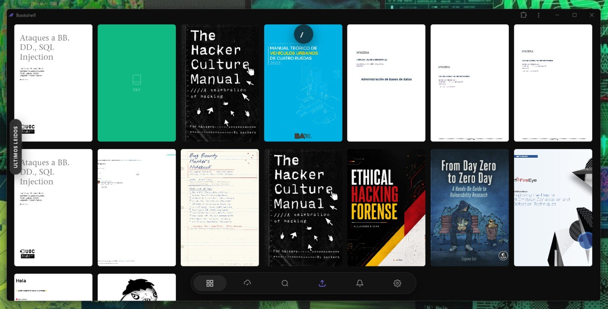
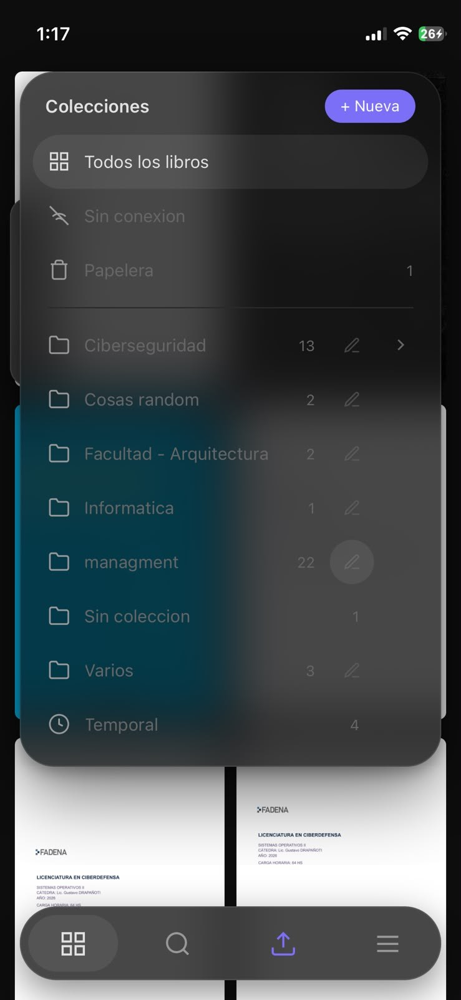
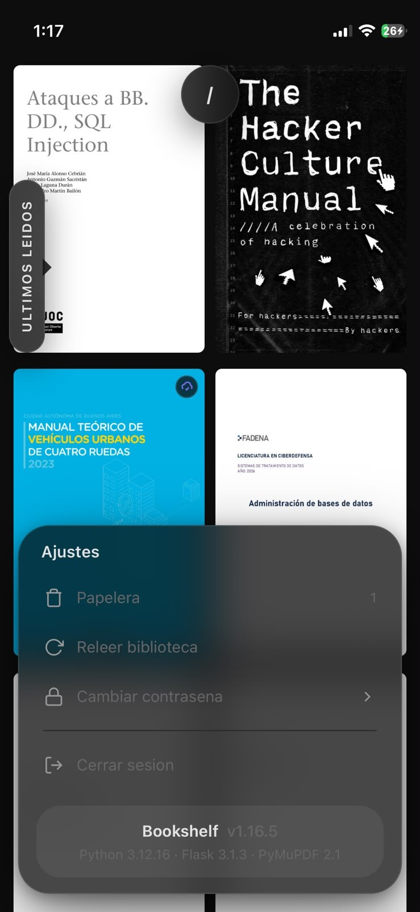
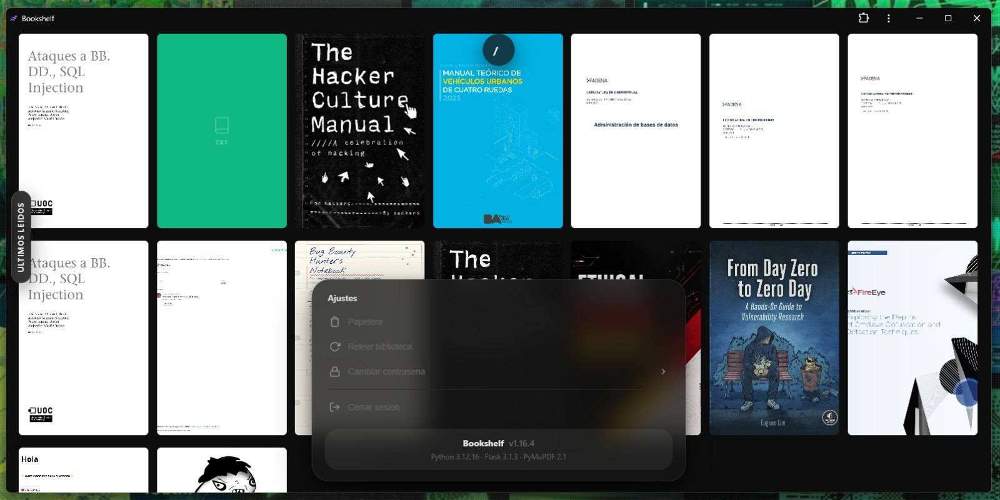

# 📚 Bookshelf

**v1.16.7** — ver [CHANGELOG.md](CHANGELOG.md) para el historial de versiones.

Tu biblioteca personal self-hosted. Drag & drop de libros, lector integrado, bookmarks y progreso sincronizado, con soporte multiusuario.

<p align="center">
  
</p>

<p align="center">
  
  &nbsp;
  
</p>

<p align="center">
  
</p>

## Cómo se usa

Celu y PC comparten la misma interfaz: **dos barras de vidrio flotando sobre los libros** (ver [docs/pildoras.md](docs/pildoras.md)).

- **Arriba, la ruta** (`/`, `/ Ciberseguridad / Malware`). Cada tramo lleva ahí; tocar la barra en cualquier otro lado la ensancha y baja el **panel de colecciones**: el árbol de carpetas, *+ Nueva* y un **lápiz al lado de cada carpeta** para renombrarla en el lugar.
- **Abajo, la píldora**. En la PC: Biblioteca, Sin conexión, Buscar, Subir, Notificaciones y Ajustes. En el celu: Biblioteca, Buscar, Subir y *Más* (Notificaciones y Ajustes). Todo lo que se abre crece desde la píldora, sin ventanas.
- **Ajustes**: Papelera, Releer biblioteca, Cambiar contraseña, Cerrar sesión y la versión.
- **El inicio**: los libros arrancan arriba de todo. *Últimos leídos* es la primera hilera en la PC; en el celu llena la primera pantalla (en un iPhone 12 mini, tres filas de dos). Después, una hilera por colección (alfabético, *Temporal* siempre última), sin títulos: el nombre lo dice una **etiqueta vertical a la izquierda** que se arrastra arriba o abajo y, tocándola, entra a esa colección.
- **En la PC**, la rueda del mouse sobre una hilera la corre de costado en la mitad derecha de la pantalla y baja la página en la izquierda.
- **El teclado** (celu) sube la barra en la que estás escribiendo, sin mover la página de atrás.

> ⚠️ **Este proyecto está pensado para correr en una red privada (LAN / VPN / servidor casero), no para exponerse directamente a internet.** El login es intencionalmente simple (usuario + contraseña, sin límite de intentos, sin 2FA) para mantener el proyecto liviano. Si igual querés exponerlo a internet, ponelo detrás de un proxy con HTTPS y considerá capas de seguridad adicionales (esto no viene "blindado" para ese escenario).

## Instalación

Hace falta **git** y **Docker** (con Compose). Sirve Linux, macOS o Windows (desde WSL o Git Bash, con Docker Desktop).

```bash
git clone https://github.com/dsecc/bookshelf.git
cd bookshelf
./setup.sh
```

Eso es todo. `setup.sh` construye la imagen, levanta el contenedor en el puerto **8090**, espera a que responda y al final te muestra:

- la dirección para entrar (en esa máquina y en tu red),
- **la contraseña del administrador**, generada al azar la primera vez (no queda `admin123`). Guardala: no se vuelve a mostrar.

Después entrá a `http://localhost:8090/admin`, creá tu usuario y usá la biblioteca con él (el admin no tiene biblioteca propia). También se puede crear desde la terminal: `./manage.sh create-user tu_nombre tu_clave`.

| Comando | Qué hace |
|---|---|
| `./setup.sh --port 9000` | Lo levanta en otro puerto (queda guardado para la próxima). |
| `./setup.sh --update` | Baja la última versión (`git pull`) y reconstruye. Los datos no se tocan. |
| `./setup.sh` otra vez | Reconstruye y levanta de nuevo, sin tocar los datos ni la contraseña. |
| `./manage.sh reset-password admin` | Cambia la contraseña del admin (si te la olvidaste). |

Tus datos viven en `data/` (la base, la clave de sesión y las portadas) y `uploads/` (los libros), dentro de la carpeta del repo. Están en `.gitignore`: nunca se suben a git. `setup.sh` guarda el puerto y el usuario con el que corre el contenedor en `.env` (también ignorado), así que un `docker compose up -d --build` a mano usa lo mismo.

> **Solo desde la misma máquina**: con `BOOKSHELF_BIND=127.0.0.1 ./setup.sh` el puerto no se abre a la red local (útil si entrás por HTTPS con `tailscale serve`, ver más abajo). Queda guardado en `.env`.
>
> Si ya tenés otro contenedor que se llama `bookshelf`: `BOOKSHELF_CONTAINER=otro_nombre ./setup.sh`.
>
> Si el Docker es viejo (20.10 o anterior) y no trae `docker compose`, el script usa `docker-compose` (con guion) solo.

## Desplegar y actualizar

El servidor es **un clon del repo**: se actualiza con `git pull` y se reconstruye en el lugar. No se copian imágenes ni archivos a mano.

```bash
cd /opt/bookshelf && git pull && docker-compose up -d --build
```

Como el repo es público, el servidor **no necesita credenciales de git** para pullear. Solo hace falta autenticarse para pushear, y eso ocurre desde la máquina de desarrollo.

Los datos viven en `./data` y `./uploads` **dentro del checkout**, montados como bind mounts por el `docker-compose.yml`. Están en `.gitignore`, así que `git pull` nunca los toca y reconstruir la imagen no los borra.

El contenedor corre como el usuario **1000** (no root), así que `data/` y `uploads/` tienen que ser de ese usuario. En una instalación que venía de una versión anterior (donde eran de root), una sola vez:

```bash
docker run --rm -v /opt/bookshelf:/b alpine chown -R 1000:1000 /b/data /b/uploads
```

## Colecciones = carpetas

Cada colección es una carpeta dentro de `uploads/<id de usuario>/`, y puede tener subcarpetas (colecciones dentro de colecciones), como una bóveda de Obsidian. Los archivos sueltos en la raíz son "Sin coleccion".

```
uploads/2/
  suelto.pdf                 → Sin coleccion
  Ciberseguridad/
    intro.pdf
    Redes/
      tcp.pdf
  Temporal/                  → lo que entra acá pasa a la papelera a los 30 días
  .papelera/                 → lo eliminado; se borra solo a los 30 días
```

- Al abrir una colección se ven sus libros **y los de todas sus subcarpetas**; al entrar a una subcarpeta se filtra a lo suyo.
- Se pueden **dejar archivos a mano** (por SSH) en cualquier carpeta y después tocar **Ajustes → Releer biblioteca** (en el celu, *Más → Ajustes*) (también se relee sola al arrancar). Un archivo movido o renombrado a mano **conserva su progreso, bookmarks y copia offline**: se reconoce por su contenido. Si el releer haría desaparecer más de la mitad de la biblioteca (la carpeta no está montada, por ejemplo), no toca nada.
- Se ignoran los archivos ocultos, los temporales (`~$`, `.part`, `.crdownload`) y los symlinks.
- La base de datos es un índice: guarda los ids, el progreso y los metadatos. Al pasar de v1.13 a v1.14, el primer arranque mueve cada archivo a la carpeta de su colección (y deja una copia de la base en `data/bookshelf.db.pre-v1.14`).

### Migrar una instalación que usaba volúmenes con nombre

Si el servidor ya venía corriendo con volúmenes de Docker (`docker volume`) en vez de bind mounts, **hay que mover los datos antes de switchear**: con los directorios vacíos, el primer arranque crea una biblioteca en blanco y una `secret_key` nueva que desloguea a todos. Nada se pierde (los volúmenes siguen ahí), pero el susto es real.

```bash
# con el contenedor PARADO, para no copiar la base a medio escribir
docker rm -f bookshelf
mkdir -p /opt/bookshelf/data /opt/bookshelf/uploads
docker run --rm -v <volumen_data>:/src -v /opt/bookshelf/data:/dst alpine sh -c 'cp -a /src/. /dst/'
docker run --rm -v <volumen_uploads>:/src -v /opt/bookshelf/uploads:/dst alpine sh -c 'cp -a /src/. /dst/'
```

Antes de levantar, verificá que estén las tres cosas que importan: `data/secret_key` (sin ella se deslogean todos los usuarios), `data/bookshelf.db` con sus filas, y que la cantidad de archivos en `uploads/` coincida con la cantidad de libros de la base. Los volúmenes viejos no se borran hasta confirmar que todo anda: son el rollback.

## Usuarios y login

Cada usuario tiene su propia biblioteca (libros, colecciones, progreso, bookmarks, highlights), completamente aislada de la de los demás. Además existe una cuenta de **administrador**, que no tiene biblioteca propia: solo sirve para crear y borrar usuarios desde `/admin`.

En una instalación nueva (clonada desde cero, sin datos previos) solo se crea automáticamente la cuenta `admin`, sin biblioteca propia. Con `./setup.sh` su contraseña se genera al azar y se muestra una vez; si levantás el contenedor a mano (`docker compose up`), arranca como `admin` / `admin123` y **hay que cambiarla apenas lo levantes** (`./manage.sh reset-password admin`). Después creá desde `/admin` las cuentas reales de cada persona.

### Cambiar la contrasena propia

Cada usuario la cambia desde **Ajustes → Cambiar contraseña**, sin depender del admin. Se pide la actual ademas de la nueva: sin eso, cualquiera con la sesion abierta en un telefono desbloqueado podria dejar al dueno afuera de su cuenta. El reseteo del admin (`/admin` o `./manage.sh reset-password`) sigue sin pedirla, porque existe para cuando el usuario ya no la sabe.

### Crear usuarios

Dos formas, usá la que te resulte más cómoda:

1. **Panel web**: entrá como `admin` en `/admin` y usá "Nuevo usuario".
2. **Script bash** (no necesita acceso a la web):
   ```bash
   ./manage.sh create-user tino claveSegura123
   ./manage.sh list-users
   ./manage.sh reset-password tino otraClave
   ./manage.sh delete-user tino
   ```

## Enviar libros entre usuarios

Desde el lector (Info y ajustes → "Enviar a otro usuario") podés mandarle cualquier libro a otra cuenta del servidor. Al destinatario le aparece una notificación — 🔔 en la píldora de la biblioteca (en el celu, dentro de *Más*), con contador de las que no vio — y al abrirla ve la portada, el título y quién se lo mandó, con la opción de aceptarlo eligiendo o creando una colección.

El archivo recién se copia a la biblioteca del destinatario al aceptar, nunca antes: si nunca lo acepta, no se duplicó nada en disco. Cerrar la notificación sin aceptar solo la marca como "vista" (deja de sumar al contador) — se puede volver a abrir y aceptar cuando quieras. Cualquier notificación, la hayas visto o no, aceptado o no, se borra sola a los 7 días de haberse recibido, para no acumular basura en el servidor.

## Leer sin conexión

Bookshelf es una PWA: se puede instalar en el teléfono ("Agregar a inicio" en iOS, "Instalar app" en Android) y abre como una app nativa.

> ⚠️ **Hace falta servir la app por HTTPS.** Esto no es opcional ni una recomendación de seguridad: los navegadores solo habilitan los *service workers* en contextos seguros, y el service worker es lo que hace todo el trabajo de caché. Entrando por `http://IP:8090` el navegador **ni siquiera expone la API** (`navigator.serviceWorker` no existe), así que no hay nada cacheado, la app no abre sin internet y el botón "Guardar sin conexión" **se oculta solo** — el código lo esconde cuando detecta que `caches` no está disponible. La única excepción que hacen los navegadores es `localhost`, que desde el teléfono no sirve.
>
> Todo lo demás (subir, leer, colecciones, envíos entre usuarios) anda perfecto por HTTP. Lo único que se pierde es el modo sin conexión.

### Servir por HTTPS con Tailscale

La forma más simple de conseguir un certificado válido sin exponer nada a internet ni comprar un dominio. Requiere Tailscale instalado en el servidor y en el teléfono, los dos en la misma tailnet.

1. Activá **HTTPS Certificates** en [login.tailscale.com/admin/dns](https://login.tailscale.com/admin/dns) (viene apagado por defecto).
2. En el servidor, poné Tailscale al frente del puerto de Bookshelf:
   ```bash
   sudo tailscale set --operator=$USER   # opcional: evita sudo a futuro
   sudo tailscale serve --bg --https=8443 http://127.0.0.1:8090
   ```
3. Abrí `https://<tu-servidor>.<tu-tailnet>.ts.net:8443` **en Safari/Chrome del teléfono** y agregala a la pantalla de inicio desde ahí.

El certificado es de Let's Encrypt, así que iOS y Android lo confían sin instalar nada. `serve` publica el servicio **solo dentro de tu tailnet** — no es `funnel`, que sí lo expondría a internet. Como Tailscale es una VPN, además la app te funciona desde cualquier lado, no solo en tu red local. Para desactivarlo: `sudo tailscale serve --https=8443 off`.

Si ya tenías la app instalada apuntando a la IP por HTTP, **borrá el ícono viejo y volvé a agregarla desde la dirección HTTPS**: es otro origen, con otro almacén de caché, así que la instalación vieja no sirve.

Dentro del lector, **Info y ajustes → "Guardar sin conexión"** descarga ese libro al dispositivo. Los libros guardados quedan listados en la sección **"Sin conexión"** de la biblioteca y se marcan con un ícono en la portada. Solo se guarda lo que elegís: nada se descarga solo, para no llenarte el teléfono.

La app en sí (la biblioteca, las portadas y el lector) queda cacheada después de la primera visita con conexión, así que abre igual sin internet — lo único que necesita estar guardado explícitamente es el archivo de cada libro.

Lo guardado vive en el *Cache Storage* del navegador, aislado por origen, y se indexa por URL: al abrir un libro sin conexión el lector pide `/api/books/<id>/file` como siempre y el service worker le devuelve la copia local, de forma indistinguible del servidor. El caché de los libros no lleva número de versión (a diferencia del de la app), así que **los libros guardados sobreviven las actualizaciones**. Al guardar el primero se llama a `navigator.storage.persist()` para que iOS no borre nada — solo lo respeta si la app está instalada en la pantalla de inicio.

> En iPhone, para que la hoja aproveche toda la pantalla (incluso por debajo de la hora y la batería, como en los PDF nativos) hay que abrirla **instalada desde la pantalla de inicio**: Safari siempre muestra su propia barra. Si ya la tenías instalada de antes, borrá el ícono y volvé a agregarla para que tome la configuración nueva.

## Formatos soportados
- **PDF** — modos Scroll y Doble página, zoom, búsqueda que marca la palabra, lupa de renglones (PC) y bookmarks
- **EPUB** — lector con fuente, tamaño y tema (los mismos controles que TXT y Markdown)
- **TXT y Markdown (.md)** — lector con fuente, tamaño, tema, búsqueda y bookmarks. El Markdown se dibuja con un renderizador propio (`static/js/mdlite.js`) que escapa todo el HTML: un `.md` compartido no puede ejecutar nada
- **MOBI, CBZ, CBR, DJVU, FB2** — descarga directa

## Funcionalidades
- 👤 Multiusuario, con bibliotecas completamente aisladas
- 🔔 Enviar un libro a otro usuario, con notificación para aceptar
- 📴 Lectura sin conexión: guardás los libros que quieras y se leen sin internet
- 📁 Colecciones como carpetas, con subcolecciones, archivos dejados a mano y *Releer biblioteca*
- ⏳ Colección *Temporal* (30 días) y *Papelera* (30 días, con restaurar)
- ⬆️ Subida por drag & drop desde el browser (varios archivos a la vez)
- 📖 Lector integrado para PDF, EPUB, TXT y Markdown
- 🔖 Bookmarks con nombre
- 📍 Progreso que te sigue entre dispositivos (abre en lo más avanzado que leíste, en cualquiera), también sin conexión (se sincroniza solo al volver internet)
- ⬇️ Descarga directa de archivos
- 🔗 Compartir link
- ✏️ Renombrar carpetas desde el panel de colecciones
- 🫧 Interfaz de vidrio con dos barras flotantes, igual en el celu y en la PC
- 📱 PWA instalable en el teléfono
- 🔍 Búsqueda de libros
